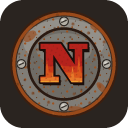

# OpenNML - No Man's Land in Rust



Faithful reimplementation of *No Man's Land: Fight for your Rights!* (2003, Related Designs / CDV). The goal is to
make the game reliably playable on modern systems again, with selected quality-of-life improvements and extended
modding options.

The project needs an existing original installation of *No Man's Land: Fight for your Rights!*. Original game files
and assets are not included.

## Status

The project is under active development.

- **Playable:** single player with custom matches, random maps, computer opponents and all four campaigns
- **In progress:** multiplayer on a local network
- **Planned:** improvements beyond the original, such as modding and presentation

## Requirements

- Original installation of *No Man's Land* (German or English edition)
- [Rust](https://rustup.rs/) - the matching version is installed automatically on the first build
- Windows

## Download

Ready-to-run builds for Windows (64 bit) are on the
[releases page](https://github.com/OpenNML/opennml/releases): download the ZIP file, unpack it to any folder and
start `OpenNML.exe`. `README.txt` in the archive explains the first start and how to check the download against its
`.sha256` file. Rust is only needed to build OpenNML from source (below).

## Quick start

```bash
cargo run --release -p opennml-game
```

The game finds the original installation itself (next to the program, in Steam and at the usual locations) and
otherwise asks for the folder once. With `--game-dir <folder>` or the environment variable `NML_GAME_DIR` you can
give a location.

## Programs

| Program | Purpose |
|---|---|
| `opennml-game` (`OpenNML.exe`) | The game |
| `opennml-viewer` | Tool for viewing maps, models, effects and menus |
| `opennml-extract` | List, unpack and convert game data to common formats |
| `opennml-viewer-mcp` | Interface for automated tests with AI tools |

Each program shows more options with `--help`; in more detail in [docs/programs.md](docs/programs.md).

## Development

```bash
cargo test --workspace
```

Some of the tests check the game data of the original installation and run only if `NML_GAME_DIR` is set.
See also [CONTRIBUTING.md](CONTRIBUTING.md).

Technical documentation on file formats, game mechanics and structure is in [docs/](docs/).

## License

| Part | License | Text |
|---|---|---|
| Source code | **GPL-3.0-or-later** | [LICENSE](LICENSE) |
| Video decoder `crates/opennml-bink` (based on FFmpeg) | **LGPL-2.1-or-later** | [COPYING.LGPLv2.1](crates/opennml-bink/COPYING.LGPLv2.1) |
| Documentation `docs/` and artwork `assets/` | **CC BY-SA 4.0** | [LICENSE-CC-BY-SA-4.0](LICENSE-CC-BY-SA-4.0) |

Rationale and the check of the dependencies: [docs/licensing.md](docs/licensing.md).

## Note on the original

OpenNML is not an official product. *No Man's Land* is a game by Related Designs, published by CDV Software; the names
and trademarks belong to their owners. This project is not affiliated with the rights holders.

You need your own original installation to play. The repository contains no game files, graphics, sounds or texts of
the original.
